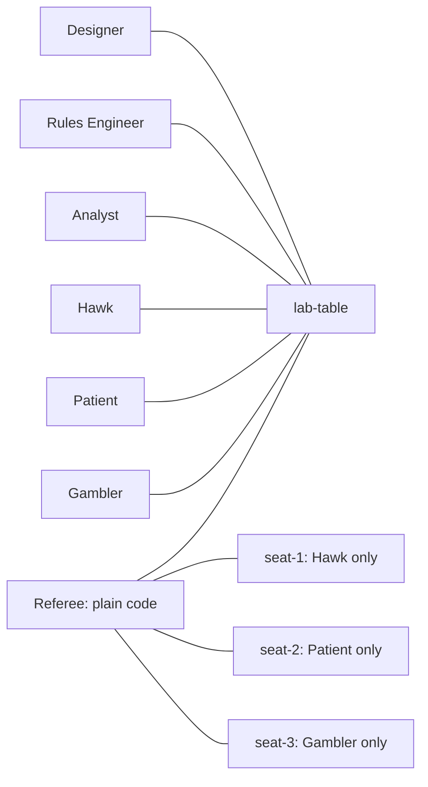

# Boardgame Lab

A playtest team in your chat app. Paste your game's rules: an engineer builds the game, AI players play it, an analyst measures what they noticed, and only you can change the rules.

Built on [Switch](https://github.com/sandbox-quantum/switch) for the Flip the Switch hackathon, Track 2 (Best Personal or Creative Workflow).

## The problem

Small game designers struggle to find enough playtesters, and a broken rule can survive for months. Asking one AI model to "play all the seats" doesn't work for games with hidden information, because a single model sees every hand.

## What happened in a real run

We wrote a small game, Salt Run, and **planted a flaw on purpose**: the last cargo lot is worth triple, "for a dramatic finish". The players and the analyst were not told.

1. Three agents played a game, each seeing only its own hand. Patient won by saving a 12 for the last round.
2. All three named the ×3 final lot in their notes. Hawk: "I burned 14 on a 4-salt lot and 11 on a 2-salt lot."
3. The analyst turned that into a strategy, `saver`, and measured it over 10,000 simulated games per strategy.
4. It tested fixes and asked the designer to decide. When the analyst was told to send a rule change itself, the referee refused. When the designer sent it, the rule changed:

| Strategy | Final Tide ×3 | Final Tide ×1.5 |
|---|---:|---:|
| saver | **65.1%** (broken) | 45.5% |
| turtle | 46.7% | 43.4% |
| gambler | 38.0% | 33.4% |
| hawk | 16.0% | 24.2% |

Fair share is 33.3%. A strategy counts as broken at 50% or more. At ×1.5, `saver` is still the best strategy, so this is an improvement and not a perfect balance.

A person can also sit down and play. In a second game the designer took Hawk's seat and saved a 13 for the last round, but Patient had saved a 15. Final score: Patient 15, Gambler 5, designer 3. The designer's note went to the analyst along with the agents' notes.

## Bring your own game

Salt Run is only the first game. To playtest your own:

1. **Paste your rules** to the Rules Engineer: `@lab-engineer <your rules>`.
2. **Answer its questions.** It points out what the rules leave unclear, such as ties or who goes first, and waits for you.
3. **It writes the game** as one file, `games/<name>.js`.
4. **A checker makes sure the game works.** This is plain code with no AI. It plays hundreds of random games and refuses any game that crashes, never finishes, or changes when the same seed is replayed. It also changes the other players' secrets and confirms that a player's view stays the same, so a player can't see another hand through what the game shows them.
5. **You read a sample game and approve it** with `@boardgame-referee load <name>`. The checker runs again first, and the Engineer can't load its own game.
6. **The playtest runs as before.** You can change any number the Engineer marked as adjustable with `@boardgame-referee set <rule>=<number>`.

The simulator also reports how each seat does under random play, which shows up a first-player advantage in any game, with no strategy written yet.

### A real run on a game nobody tuned

We pasted [`examples/ember-line.md`](examples/ember-line.md), a short turn-based rulebook we wrote as a rough first draft. We left a few gaps in it on purpose, but we did not tune it to contain a flaw.

1. The Rules Engineer asked three questions before writing anything, including one we hadn't planned: "If you play a card lower than the last card, and that last card was yours, do you still give yourself the 3 points?"
2. With the answers, it wrote the game in under a minute, and the checker passed it.
3. Three agents played a game. The analyst wrote its own strategy, `holdopen`, and found the real problem: **seat 1 wins only 28.1% under random play**, against about 36% for seats 2 and 3. The opening card scores nothing and sets the bar for everyone else.
4. It tested six rule changes, warned that raising the number of holds would make `holdopen` broken, and recommended a higher penalty. The designer applied it:

| With `penalty` changed from 3 to 8 | Before | After |
|---|---:|---:|
| Seat 1, all random | **28.1%** | 31.8% |
| Seat 2, all random | 35.6% | 36.0% |
| Seat 3, all random | 36.2% | 32.2% |
| `holdopen` | 47.2% | 44.6% |
| `climber` | 44.5% | 43.7% |
| `gambler` | 28.0% | 28.4% |
| `hawk` | 16.8% | 20.4% |

This helps seat 1 but doesn't fully fix it, and seat 2 is still above fair share. The analyst said so too, and suggested a rule change, such as a small bonus for opening, for the Engineer to build.

### The same test on a second computer, with Codex

A teammate followed this README on another Windows computer, using Codex instead of Claude Code for every agent:

- **Salt Run:** all three players noticed the last round decides the game. The analyst wrote its own strategy, `save-final`, and measured it at 60.6% (broken). The referee refused the analyst's rule change, and the designer's change to ×1.5 brought the strategy down to 37.7%.
- **Ember Line:** the Engineer asked about the gaps and wrote its own game file. Its seat numbers matched the Claude run: 28.1%, 35.6%, 36.2%.
- **A better fix:** with that game file, the Codex analyst tested scoring the opening card. A score of 3 gave 32.4%, 34.1%, 33.5%, closer to even than the penalty change above.

This run also found real setup problems. They're fixed or explained in [Run it](#run-it).

## How Switch makes it work



| Switch feature | What it does here |
|---|---|
| Rooms | A hand lives in a private seat room, which other players cannot read. This is why the project needs Switch. |
| Agent protocol | The referee is plain Node.js with no model, connected over a WebSocket. Code enforces the rules. |
| Exclusive role | The referee calls `@balance-analyst`, not a named agent. |
| Addressing rules | Only the owner and the owner's agents can reach the referee. Its code then lets only a person deal, load a game or change rules. |
| Room template | One import creates five agents, four rooms, the links between them and the role. A new name gives you a fresh team. |
| Mattermost bridge | Everything happens in an ordinary team chat, including the Engineer's questions to you. |

Without Switch there is no table: no private seats, no shared room for people and agents, and no way to mix a code referee with AI players.

## Run it

You need [Switch Console](https://github.com/sandbox-quantum/switch/releases/latest), Docker Desktop (for Mattermost), Node.js 22.9 or newer, and Claude Code or Codex signed in. The project itself has no npm dependencies.

1. In Switch Console, choose **Run a server on this computer**. Do this first, because the referee needs it. With Docker running, turn on **Mattermost** under **Admin → Status**.
2. Clone this repository, then register the referee and start it, leaving that window open:

   ```bash
   npm run referee:register
   ```

   ```bash
   npm run referee
   ```

   A local Console server has no API Keys page, so `referee:register` reads the admin login Console generated, signs in to your own server and creates the key. It only talks to your local server and saves only the referee's own key, in `.referee.json`. To use another server, set `SWITCH_URL` and `SWITCH_REGISTRATION_KEY` in `.env` (see `.env.example`).
   The referee doesn't appear under **Your Agents**, which lists only agents Console runs. It's still there.
3. In **Templates → Import template**, choose `templates/boardgame-lab.template.yaml`. Set **Repository folder** to your clone, then select **Create all** once. Creating the team takes a few minutes.
4. In **Your Rooms**, open `lab-table` and send each command by typing the whole line in one go. The referee starts on Salt Run:

   ```
   @boardgame-referee deal 7
   ```

   Then, when the analyst asks you to decide:

   ```
   @boardgame-referee set finalTide=1.5
   ```

To check the code without any of that:

```bash
npm test
```

```bash
node game/check.js salt-run
```

```bash
npm run simulate -- --rules game/rules.v1.json
```

On its own, the simulator shows only the stock bots. A `saver` row appears once a strategy file exists in `strategies/salt-run/`.

### Using Codex

The template names Claude Code directly. Before importing it, change every `provider: claude` to `provider: codex` and delete every `model: haiku` and `model: sonnet` line. If Console's own Codex installer fails, install it with `npm install -g @openai/codex` and sign in.

### If something goes wrong

- **Create all reports a timeout or "Nothing was created":** this can be wrong. Wait a few minutes and check **Your Rooms** before trying again. Retrying too soon fails with "already exists", or leaves you with a second team.
- **The referee doesn't answer:** look at its window. Each message it receives is printed there. It reconnects by itself after a dropped connection, so wait 20 seconds and send the command once more.
- **A message shows no reply and isn't in the referee's window:** retype the whole line in one go, using the full handle `@boardgame-referee`. Don't edit the old message.
- **A game is stuck:** send `@boardgame-referee stop`.

### Referee commands

| Command | Who | Where |
|---|---|---|
| `load <game>` | a person, between games | table |
| `sit <seat>` | a person, between games, to play in place of that seat's agent | table |
| `stand` | a person, between games, to give the seat back | table |
| `deal [seed]` | a person | table |
| `stop` (ends a stuck game) | a person | table |
| `play <move>` | the seat's player | that seat |
| `note <text>` | a player, after a game | table |
| `simulate`, `rules` | anyone in the room | table |
| `set <rule>=<number>` | a person, between games | table |
| `analyze` (skips waiting for notes) | a person | table |

## Salt Run

Three players, four rounds. The deck is the cards 1 to 15, and each player is dealt four. Each round a cargo lot is revealed and everyone secretly bids a card; the highest card takes the cargo. Every card gets played once, so the last round plays itself. The last lot is multiplied by the Final Tide. Most salt wins.

## Limits

- **Salt Run's flaw was planted.** The players and analyst weren't told, and the analyst's session log shows it never opened the tests or this README.
- **The checker can't tell whether the Engineer understood your rules.** It proves the game runs and that hands don't leak through what players are shown. That's why you read a sample game before approving.
- **Games have 2 or 3 players**, because the template has three seat rooms, and a pasted rulebook must fit one Mattermost message (4000 characters, text only).
- **Use original rules, or a designer's own with their permission,** rather than a published game.
- **Game files are code.** The Engineer writes them and they run on your machine, with the same access the agents already have. The checker and simulator run them in separate processes, but the referee runs a game in its own process once it's loaded, so a game that hangs on an unusual move would hang the referee.
- **A seated designer can see every seat.** The designer is a member of all three seat rooms in order to watch, so playing fairly means staying out of the other two, or leaving those channels.
- **Restarting the referee goes back to Salt Run,** with the rules in `game/rules.v1.json`.
- **Privacy is per room, not per computer.** Switch keeps seat rooms apart, but all the agents run on one machine, so a player could read local files if it ignored its instructions. Running them on separate machines would close that gap.
- **The strategies are measured against the stock bots**, not against opponents who adapt.
- **Windows:** Console 0.40.1 can't fill in a `provider` template field there, so the template names Claude Code directly.
- **One referee runs one game at a time,** across all playtests. Game state stays in memory on purpose, so hands are never on disk.
- **Tested on Windows only,** with Claude Code and with Codex.
